# C-Ink

A custom OS for the [ENILINX TICKEY](https://enilinxtickey.com/) e-ink badge that uses Claude to put the single most relevant thing in your day on its 3.7" screen: the meeting you are about to walk into, when to leave for it, the PRs, Slack threads and emails that need you, the Claude Code session waiting on your OK, the deploy that just broke, and a few fun ones on top. It is laid out for wearing the badge upright, with a small Clawd sitting on the Up next line whose pose follows what is on screen.

> [!WARNING]
> **C-Ink is highly experimental.** It replaces your TICKEY's firmware with unofficial software built without published hardware documentation. Flashing it can leave your device unusable, and you do it entirely at your own risk. **I am in no way responsible for bricked or broken devices**, lost data, or anything else that happens from using this project. Keep a backup of the stock firmware (`tools/tickey-probe` makes one) before you flash anything.

<p>
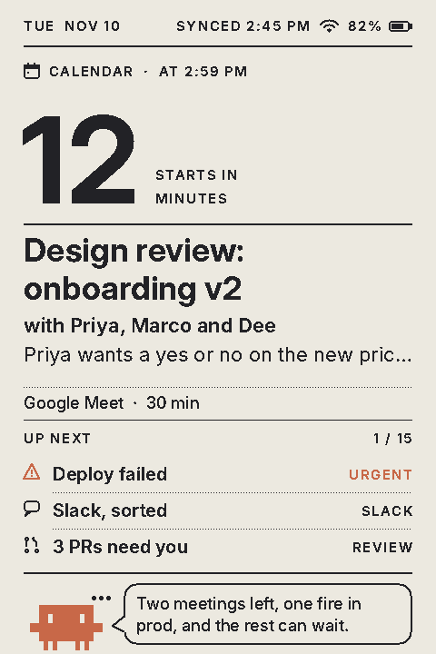
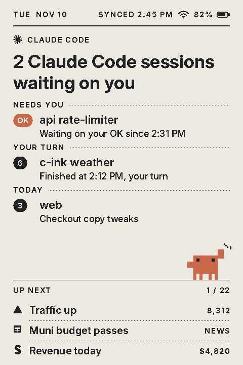
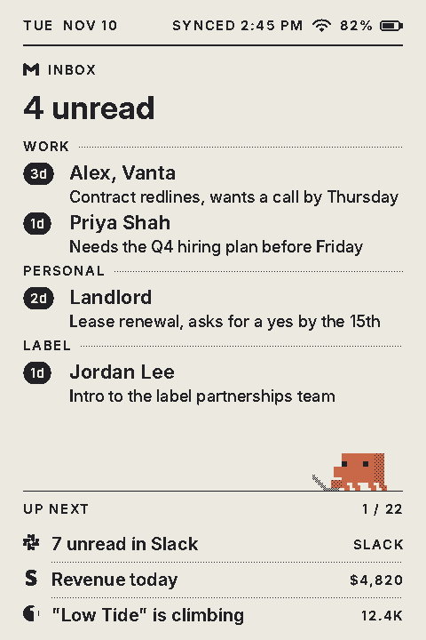
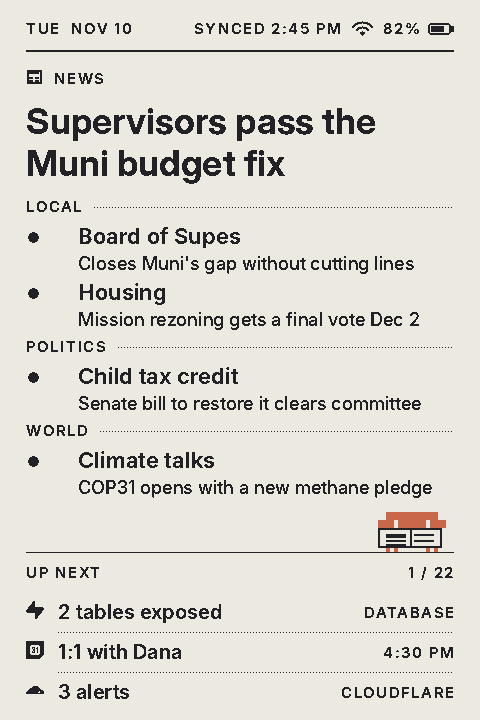
</p>

These are real frames from the device's renderer (`sim/`), with invented sample data. Every screen is further down.

## Bring your own Claude Code

C-Ink has no accounts, no API keys and no servers of its own (the optional relay for syncing away from home is a Worker you deploy yourself, and it only ever holds ciphertext). It runs **the Claude Code you already have**, signed in with **your own Claude subscription**, and every connector it reads (Calendar, Gmail, Outlook, Slack, Teams, GitHub, Intercom and the rest) is a connector **you add once on claude.ai**. Claude Code picks them up automatically, and C-Ink simply asks it to read them.

That is the whole integration story, and it is why C-Ink can cover twenty-odd services without shipping twenty-odd integrations:

- **One sign-in.** You sign in to Claude Code once. There is no Google Cloud project, Slack app, OAuth client or API token to create per service (Cloudflare's optional read-only token is the one exception, for alerts and site traffic no connector covers).
- **Connect once, use everywhere.** A connector you add on claude.ai works in Claude, in Claude Code and on your badge at the same time. Add a second Gmail or Google Drive account and the Inbox and Docs screens pick it up on the next run.
- **Nothing new to pay for.** Runs come out of your existing Claude plan. There is no C-Ink subscription and no hosted backend holding your data.
- **Your data stays between you and Claude.** C-Ink allows Claude Code only read-only tools, runs it on your own computer, and sends the device a digest encrypted for that device alone.

You need a Claude plan that includes Claude Code, and the Claude Code CLI on the computer that runs C-Ink Settings (the app links to the installer if it is missing).

## How it works

```
 claude.ai connectors            your Mac / PC                                 TICKEY (ESP32-S3)
 (Calendar, Slack, Gmail,  ┌──────────────────────────────┐   LAN (mDNS)    ┌────────────────────────┐
  GitHub, Linear, Vercel,  │ C-Ink Settings               │ ──────────────▶ │ wake ▸ sync ▸ re-rank  │
  Stripe, ONCE, Tavern…)   │  ├ runs your own `claude -p` │   sealed blob   │ ▸ draw ▸ deep sleep    │
        ▲                  │  │  read-only tools only     │                 │                        │
        └──────────────────│  ├ trims to a 20 KB digest   │   relay (opt.)  │ 12 h of cards cached,  │
                           │  ├ seals it per device (AES) │ ──▶ ☁ ──▶       │ ranked on-device as    │
                           │  └ serves it + previews it   │  ciphertext only│ the day moves          │
                           └──────────────────────────────┘                 └────────────────────────┘
```

1. **Claude plans the day.** The first run each morning, C-Ink Settings has your Claude Code read every connector and do a chief of staff's homework: for each meeting it reads the invite and linked docs, finds the doc it is about in Drive or SharePoint, and checks recent email, Slack and Teams threads with the people in it. It writes the screens and a plan for the day. C-Ink allows only read-only tools, so nothing gets sent, edited or deleted.
2. **Claude checks in.** Every hour (or every 30 minutes, 2 hours, 4 hours, or never, your call) Claude looks at what changed since and adjusts the plan and the screens. Between check-ins, every refresh re-reads just your calendars with a small, fast run, so a moved or cancelled meeting shows up within minutes with plain text until the next check-in rewrites it.
3. **The device does the timing.** Each digest is a short timeline: cards with priorities and time windows. The TICKEY re-ranks it every time it wakes, so a meeting climbs to the top as it gets close and drops off when it ends, with or without Wi-Fi.
4. **Only changes cost power.** When nothing changed, the digest keeps the same bytes and ETag, so the badge gets a 304 and redraws nothing; Weather is cached for 30 minutes. Off Wi-Fi it keeps showing its last sync. The screen only redraws when the pixels change. Fast 1-bit refreshes by default, a full refresh when the accent color matters or ghosting builds up. Deep sleep in between, waking for the next sync, the next screen change, or a button.

## Screens

Every source you connect feeds one or more screens. Each screen has a full view, shown when it is the most relevant thing, and a one-line row in **Up next**. Each can be switched off on its own in the Marketplace, and the device skips switched-off screens even in its cached digest.

| | | | |
|:-:|:-:|:-:|:-:|
| <br>**Next up** | 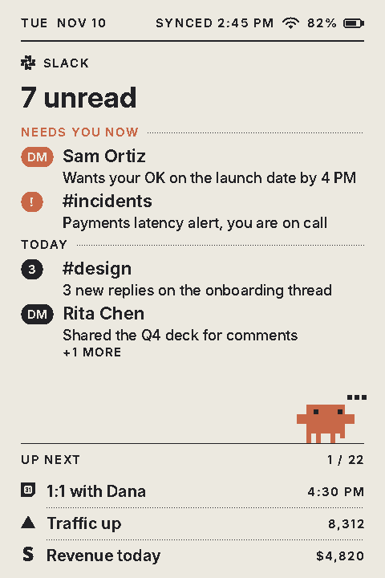<br>**Slack** | <br>**Inbox** | 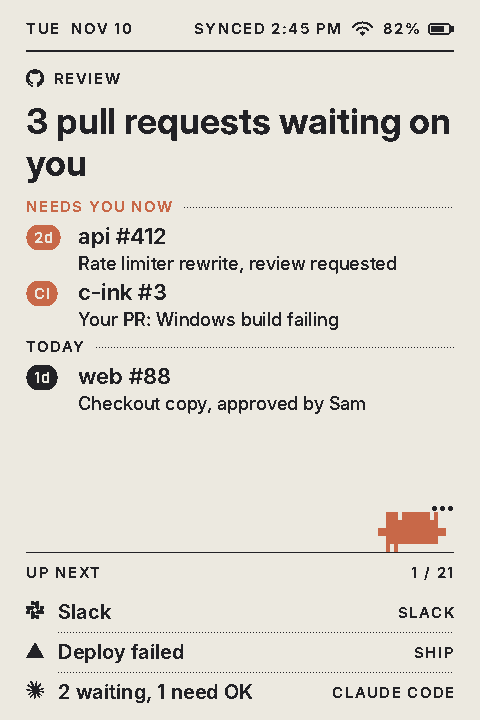<br>**Pull requests** |
| 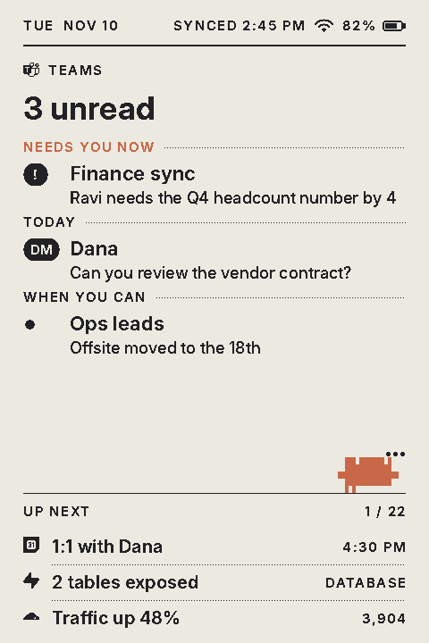<br>**Teams** | 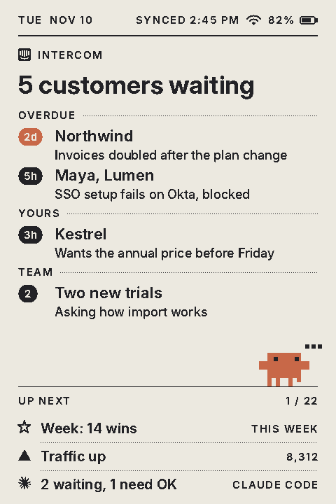<br>**Customer inbox** | <br>**Claude Code** | <br>**Morning news** |
| 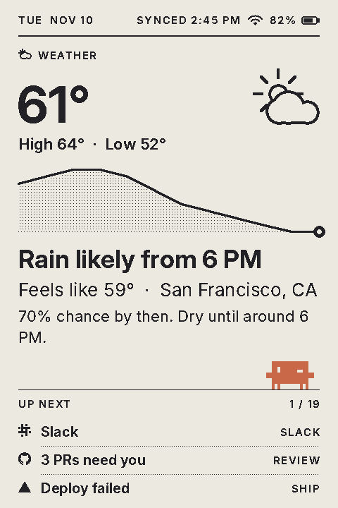<br>**Weather** | 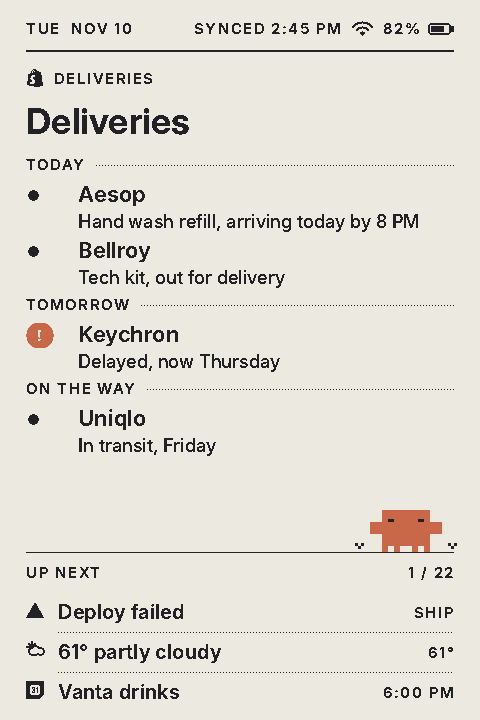<br>**Deliveries** | 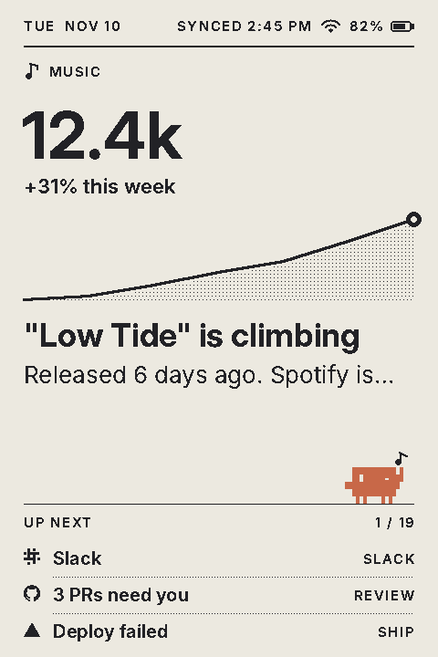<br>**Releases (ONCE)** | 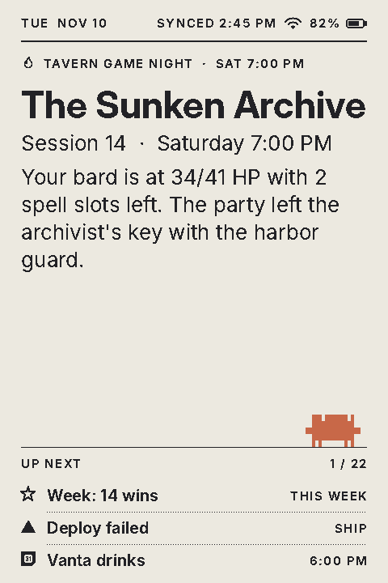<br>**Game night (Tavern)** |
| 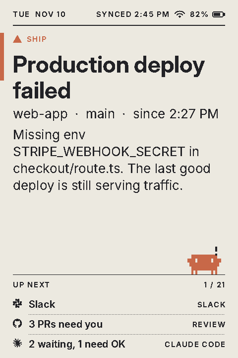<br>**Ship status** | 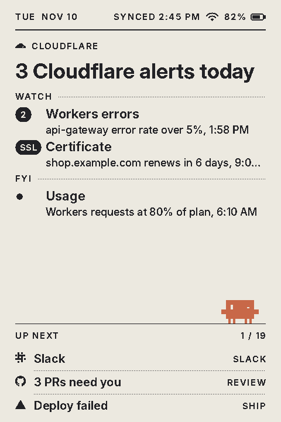<br>**Cloudflare alerts** | 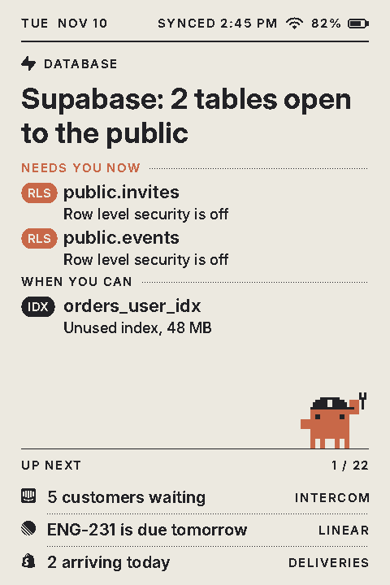<br>**Database health** | 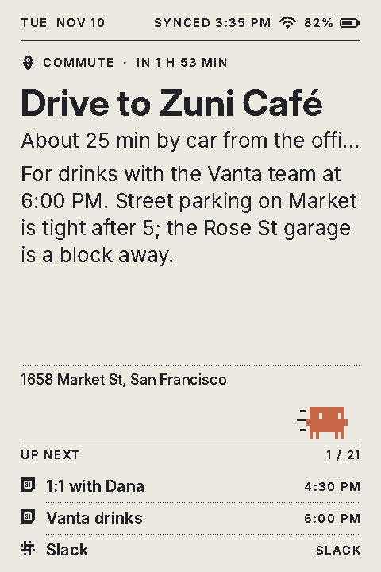<br>**Commute** |
| 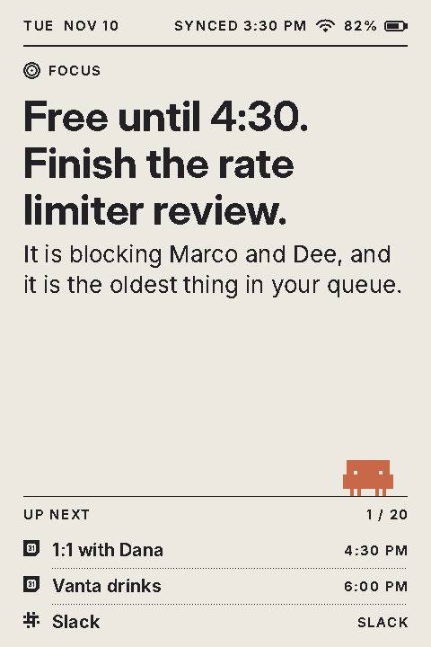<br>**Focus window** | 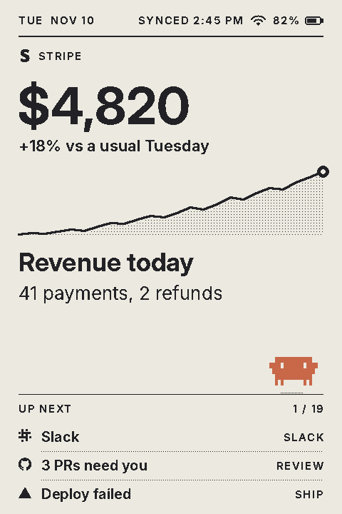<br>**Revenue** | 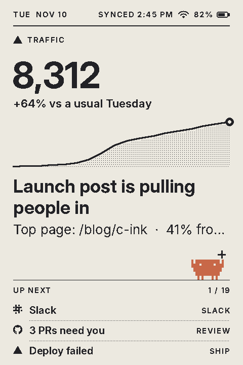<br>**Traffic** | 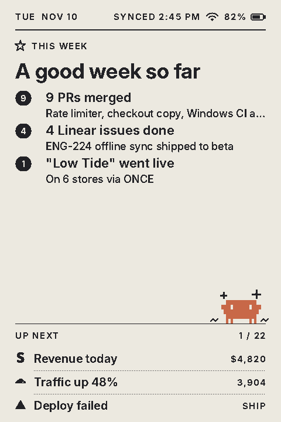<br>**This week's wins** |
| 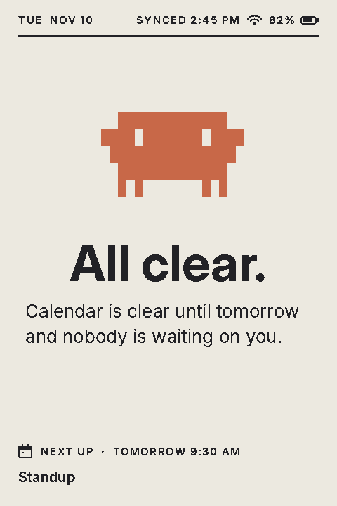<br>**All clear** | 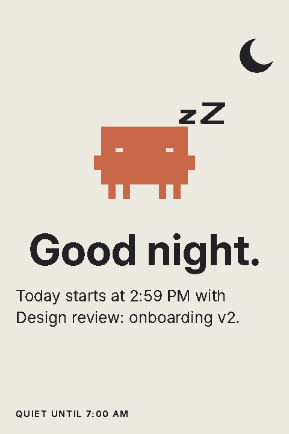<br>**Night** | 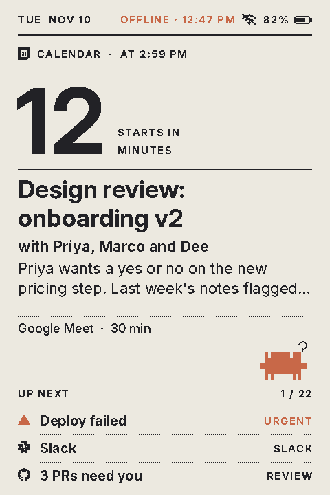<br>**Offline** | 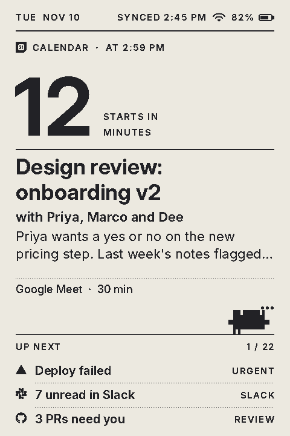<br>**Black and white** |
| 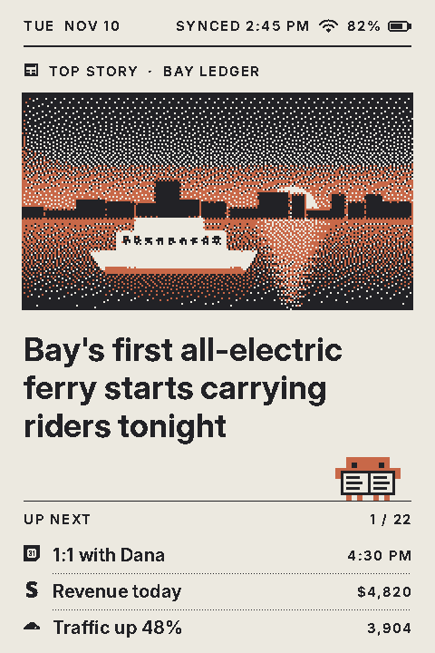<br>**Top story** | 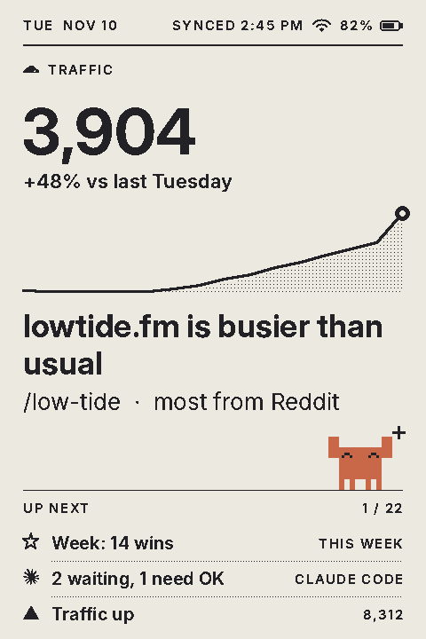<br>**Traffic (Cloudflare)** | 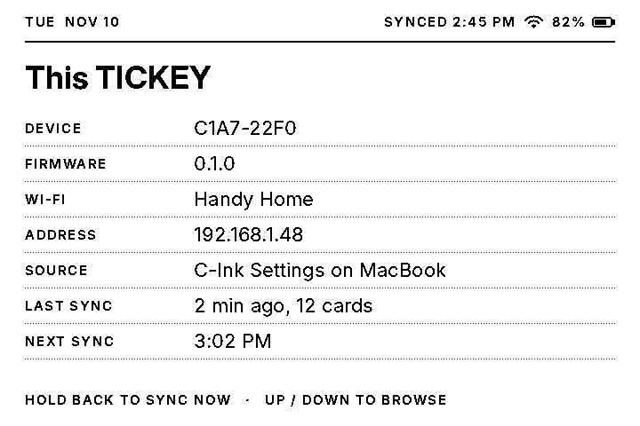<br>**Device info** | 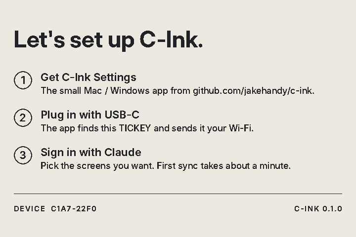<br>**Setup** |

| Screen | Source | What it shows |
|---|---|---|
| Next up | Google Calendar, Outlook | Countdown to your next meeting plus the one thing to know going in, researched across your mail, chat and docs |
| Commute | Google Calendar | When to leave for your next in-person meeting. Claude estimates door to door from where you will be before it and how you get around, plus your buffer |
| Focus window | Google Calendar | When you have a real gap, the one thing worth doing with it |
| Slack | Slack | Messages grouped into *needs you now*, *today*, *when you can* |
| Inbox | Gmail (one connector per account), Outlook | Threads where a person is waiting on you, with a section per account |
| Teams | Microsoft 365 | Teams chats and channel mentions, grouped like Slack |
| Customer inbox | Intercom | Customer conversations waiting on you or your team, longest wait first |
| Pull requests | GitHub (or the `gh` CLI) | Reviews waiting on you, your PRs failing CI |
| This week's wins | GitHub, Linear, Vercel, ONCE | Merged PRs, closed issues and releases, from Thursday afternoon on |
| Linear | Linear | Issues due soon or blocking someone |
| Ship status | Vercel | Failed production deploys and error spikes |
| Traffic | Vercel Web Analytics, Cloudflare (API token) | Page views today against the same day last week, top page and referrer |
| Cloudflare alerts | Cloudflare (API token) | Notifications from the last day: Workers errors, origin and DDoS alerts, certificates |
| Database health | Supabase | Tables with row level security off, advisor warnings, paused projects |
| Revenue | Stripe | Today against a usual day for that weekday, with a sparkline |
| Deliveries | Shop, order emails in Gmail or Outlook | Packages arriving today or delayed |
| Releases | ONCE | How your latest release is doing this week: streams, stores, anything stuck in review |
| Game night | Tavern | Your next tabletop session, where the last one left off, and where your character stands |
| Docs | Google Drive (one connector per account), SharePoint and OneDrive | Docs waiting on your comments, and the one to read before your next meeting |
| Claude Code | This computer | Sessions waiting on your OK or your reply, commits today, token use |
| Weather | Open-Meteo | Now, today's high and low, and when rain starts, for the place you set |
| Morning news | The web | A morning briefing from your own prompt, researched once a morning |
| Top story | The web | The day's one big story, full screen with its lead photo dithered into the panel's black and orange. Cycles in for 15 minutes every 45 |
| Brief & wrap, Anything else | Claude | A morning brief, an end-of-day wrap, and anything important that fits nowhere else |

**ONCE** ([once.app](https://once.app)) is a music release platform: artists and labels use it to send songs and albums to Spotify, Apple Music and the other stores, manage their catalog, and see how each release performs. **Tavern** keeps a tabletop roleplaying group's campaign in one place: dated sessions with everyone's notes, a wiki of the people and places in it, maps, character sheets with live hit points and spell slots, and a combat tracker. If you use neither, leave them off; nothing else depends on them.

Four screens never cost a Claude run: **Weather** comes straight from Open-Meteo (only the place you set is sent there), **Cloudflare alerts and traffic** from Cloudflare's notification history and zone analytics with a read-only token, and **Claude Code** from the session logs on your computer. That last one reads timing, token counts, folder and branch names only, never what was said, and none of it goes to Claude. **Morning news** is one extra Claude run a morning that can only search and read the web: no connectors are loaded in it, so nothing on the open web can reach your mail or calendar. The same run picks the **Top story**; its photo is downloaded and dithered on your computer, so the badge never fetches anything from the web.

Buttons: **Up/Down** page through every card in Up next, **Back** returns to the top card (press again for device info), **hold Back** to sync now. Leave the buttons alone for 20 seconds, or let it go back to sleep, and it returns to whatever is most relevant at that moment. If you wear it the other way up, tick **Orientation** in Settings: the picture turns 180° and Up and Down swap.

### Clawd

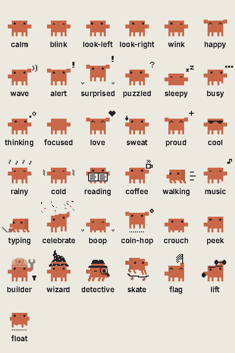

Clawd sits on the right end of the Up next line and changes pose with the top card: hopping when a meeting is five minutes out, tapping a foot when it is fifteen, at his laptop while a Claude Code session works or email replies are waiting, a starry wizard hat when the sessions have finished, waving when one needs you, a fedora and magnifier for pull requests, a hard hat and wrench for deploys and databases, peeking over the paper with the news, sunglasses on a clear day, rain overhead when it is wet, skateboarding to a meeting, a checkered flag or a confetti jump for a good week, a dumbbell for a focus block, a coin hop when revenue is up, a sweat drop when three things are on fire, asleep at night, puzzled offline. 37 poses in all, every one on the same pixel grid with his solid black eyes; the hats, tools and action poses are traced pixel for pixel from Anthropic's own Clawd art, drawn by `tools/clawdgen.py`.

<br clear="right">

## Marketplace

C-Ink Settings lists every source in a small Marketplace, grouped by type (calendar and email, chat and support, build and ship, business, docs and files, shopping, life and play). Each one opens to a short connect flow and the switches for its screens. Almost every flow is the same two steps: add the connector on claude.ai, press **Recheck**.

<p>
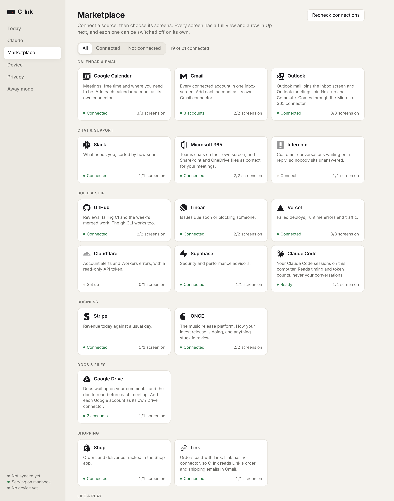
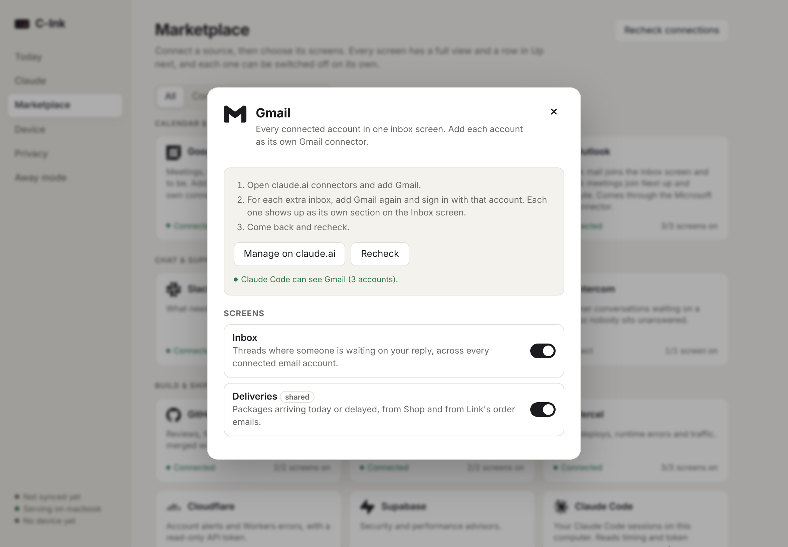
</p>

- **claude.ai connectors** (Google Calendar, Gmail, Microsoft 365 for Outlook, Teams and SharePoint, Slack, Intercom, GitHub, Linear, Vercel, Supabase, Stripe, Shop, ONCE, Tavern, Google Drive): connect on claude.ai, then **Recheck**. Add Gmail or Google Drive once per account for multiple accounts.
- **Built in:** Weather takes a zip code, city or coordinates. Cloudflare takes a read-only API token (Notifications: Read and Account Settings: Read for alerts, plus Zone: Read and Analytics: Read for Traffic); pick the site Traffic follows, or let it follow the busiest one. News takes a sentence describing what you want, for example *"Local news for my zip code, progressive political news, and general news."*
- **On this computer:** Claude Code is found automatically.

## Repo layout

| Path | What |
|---|---|
| `firmware/` | ESP-IDF 5.4 project for the TICKEY. `components/cink_core` is the portable renderer, ranking and digest parser; `components/cink_hal` the board layer; `main/` the app (sync, cache, USB setup link, sleep). |
| `sim/` | Builds `cink_core` for your computer: renders frames to PNG and runs the core tests. |
| `desktop/` | C-Ink Settings (Tauri 2, Mac / Windows / Linux) and `cink-bridge`, the Rust library that runs Claude, builds and seals digests and serves them. Also builds as a headless `cink-bridge` binary for an always-on machine. |
| `relay/` | Optional Cloudflare Worker so the TICKEY can sync away from home. Stores ciphertext only. |
| `tools/` | Font and app-icon rasterizers, the screenshot renderer for this README, the firmware size check, and `tickey-probe`, which reads the TICKEY's pin map off its stock firmware. |
| `docs/` | [Architecture](docs/architecture.md), [wire protocol](docs/protocol.md), [hardware notes](docs/hardware.md). |

## Getting started

1. **Install C-Ink Settings** from the latest CI build (macOS `.dmg`, Windows `.exe`/`.msi`). The builds are unsigned for now: on macOS right-click → Open the first time.
2. **Claude tab:** sign in to Claude Code with your own Claude account (the app links to the installer if it is missing). Pick how often Claude checks in after the morning plan. Then open the **Marketplace**, add the connectors you use on claude.ai, and switch on the screens you want.
3. **Back up and flash the firmware** (read the warning at the top first; see [hardware notes](docs/hardware.md); `idf.py -p <port> flash` from `firmware/`).
4. **Device tab:** plug the TICKEY in with USB-C, add your Wi-Fi networks, press **Send to TICKEY**. It pairs, gets its key, and shows today's digest right away. Quiet hours (10 PM to 7 AM by default) are on the same page.

## Size

The firmware image is 1.1 MB, 13% of the 8 MB flash (CI fails the build above 2 MB). The fonts are the biggest piece of C-Ink's own code at ~210 KB; the rest is ESP-IDF, Wi-Fi and TLS. In RAM, the frame (86 KB), the digest with its story photo (49 KB) and the 32 KB sync buffer are static, and ~69 KB of internal DRAM is left for Wi-Fi and TLS at runtime. No PSRAM required.

## Status

Everything above the display runs today: digest generation, sealing, LAN and relay sync, caching, ranking, rendering, USB setup, buttons and sleep. ENILINX has not published the TICKEY's pinout or panel driver yet, so C-Ink learns them instead of waiting: `tools/tickey-probe` reads the pin map off the stock firmware over USB-JTAG, C-Ink Settings sends it to the device as a board profile, a scripted SPI e-paper driver runs the panel from that profile, and **Learn buttons** finds the buttons by watching the pins. If the probe shows a waveform-driven parallel panel (likely, given the Modos driver), that needs one more backend; see [docs/hardware.md](docs/hardware.md#getting-past-the-missing-panel-driver) for the steps and the honest limits.

## Development

```sh
# renderer + tests
cmake -S sim -B sim/build && cmake --build sim/build -j && ./sim/build/cink_tests
./sim/build/cink_sim sim/fixtures/day.json --tz PST8PDT,M3.2.0,M11.1.0 --now 1794350820 --out frame.png --paper

# every screenshot in this README
python3 sim/fixtures/make_fixtures.py && python3 tools/render_screens.py

# bridge + desktop app
cd desktop && cargo test -p cink-bridge && npx @tauri-apps/cli@2 dev

# firmware
cd firmware && idf.py set-target esp32s3 build
```

## Trademarks

Brand names and logos (Google Calendar, Gmail, Google Drive, Microsoft 365, Outlook, Teams, Slack, Intercom, GitHub, Linear, Vercel, Cloudflare, Supabase, Stripe, Shopify, Notion, Spotify, ONCE, Tavern, Claude) belong to their owners. Monochrome marks come from [Simple Icons](https://simpleicons.org) (CC0) or from their owners, and are used only to label where a card's information comes from. C-Ink is not affiliated with or endorsed by any of them, or by ENILINX.
